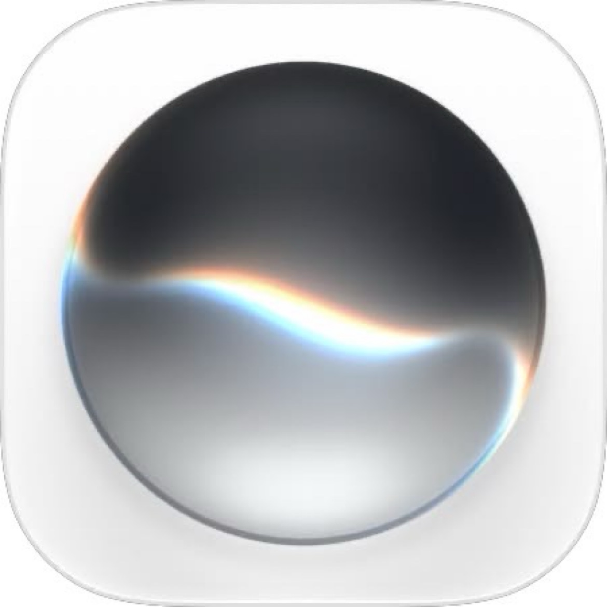

# Siri AI by Adnan.120hz

  

An AI chat application for iOS, designed in the spirit of Siri. No account required, no login necessary. Simply open the application and begin conversing.

## Overview

Siri AI is a native iOS chat application powered by Groq's high-speed AI inference. It delivers concise, intelligent responses in a clean and familiar conversational interface.

## Features

- **AI Chat** — natural conversations with a fast, capable language model.
- **Conversation History** — multiple conversations stored locally on your device (SwiftData). Search and revisit past chats at any time.
- **Source Import** — attach documents (PDF, ZIP) and have their contents extracted into the chat context.
- **Voice Mode** — speak to the AI and hear spoken responses (on-device speech recognition and text-to-speech).
- **Photo & Video** — send images for visual understanding; video frames are extracted automatically.
- **Local Memory** — the AI learns facts about you over time, stored entirely on your device. Fully optional and erasable.
- **Prompt Modes** (Premium) — Gaul, Formal, Santai, and Custom speaking styles.
- **Voice Selection** — multiple system voices, with an extended voice menu for Premium users.

## Premium

Upgrade to Premium via the Subscriptions menu in the app to unlock:

- **File reading** — PDF and ZIP files read directly by the AI.
- **Many voice options** — all real system voices, pick whichever you like.
- **Prompt modes** — AI speaking style: Gaul, Formal, Santai, or Custom.
- **50 GB storage** — local storage grows from 25 GB to 50 GB.
- **Unlimited messages & topics** — no 20-message cap per chat and no daily limit.
- **Own quota key** — uses a dedicated premium API key for higher reliability.

## AI Quota

The application includes a daily AI usage quota. **Your quota refreshes automatically every day** — no manual action is required. If you reach the daily limit, simply wait until the next day, or upgrade to Premium for a higher allowance.

## Important Notice

**This application will expire on January 16, 2027.** After this date, the application will no longer function. Please plan accordingly.

## Installation

The unsigned IPA is available under [Releases](../../releases). Install via sideloading (Sideloadly, AltStore, or TrollStore) and sign with your own certificate.

## Build

Pushing to `main` triggers GitHub Actions (macOS, Xcode 26), producing an unsigned IPA as a build artifact. API keys are injected at build time from GitHub Secrets and are never committed to this repository.

## Credits

Developed by **Adnan.120hz**.

- AI inference powered by [Groq](https://groq.com).
- Contact: [t.me/adnan120hz](https://t.me/adnan120hz) · TikTok [@adnan.120hz](https://tiktok.com/@adnan.120hz)

---

© 2026 Adnan.120hz. All rights reserved.
